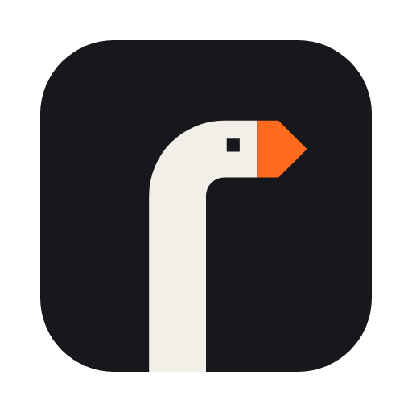

<p align="center"></p>

# CyberGoose

CyberGoose, yerel dosyalar ile FTP, FTPS, SFTP, Dropbox ve Google Drive arasında dosya aktaran iki panelli bir masaüstü dosya yöneticisidir. Windows için tek bir `.exe` olarak paketlenir.

- İki panel: yerel ve uzak. Klasörde gezinme, arama, sıralama ve sağ tık menüsü vardır.
- Kayıtlı bağlantılar ve klasör yer imleri tutulur. Parolalar arayüze hiç dönmez.
- Yükleme ve indirme bir kuyrukta yapılır. Hedefte aynı dosya varsa üzerine yazma sorulur, hatalı aktarım yeniden denenebilir.
- Dosya detayları: SHA-256, metin önizlemesi ve uzak dosya izinleri (chmod).
- Graphite (koyu) ve Paper (açık) temaları ve logolu bir açılış ekranı vardır.
- Bir şey çalışmazsa uygulama örnek veri göstermez, gerçek hatayı gösterir.

## Proje yapısı

```text
backend/    Python yerel API (Flask + waitress), sağlayıcılar, SQLite, pytest
frontend/   React + TypeScript + Vite arayüzü
desktop/    Electron kabuğu, backend'i başlatan kod, uygulama ikonu
docs/       Mimari belge
```

Ayrıntılar: [docs/ARCHITECTURE.md](docs/ARCHITECTURE.md)

## Gereksinimler

- Node.js 20 veya üstü
- Python 3.11 veya üstü (Windows'ta `py` başlatıcısı ya da PATH'te `python`)

## Kurulum

```powershell
npm run setup
```

`npm run setup` şunları yapar:

- kökteki Electron araçlarını ve `frontend/` bağımlılıklarını kurar,
- `backend\.venv` sanal ortamını oluşturur (yoksa),
- `backend/requirements-dev.txt` içindeki Python paketlerini bu ortama kurar.

Venv'i elle etkinleştirmeniz gerekmez. Backend komutları (`dev:backend`, `test:backend`, `build:backend`) `scripts/python.cjs` aracılığıyla `backend\.venv` içindeki Python'u kendiliğinden kullanır. Sanal ortam yoksa ya da paketler eksikse komut ne yapılacağını söyleyen bir hata verir. Python paketleri değişirse yalnızca `npm run setup:backend` çalıştırmak yeterlidir.

Bulut hesapları için `backend/.env.example` dosyasını `backend/.env` olarak kopyalayıp doldurun:

- **Dropbox:** <https://www.dropbox.com/developers/apps> adresinde bir uygulama oluşturun. `DROPBOX_APP_KEY` ve `DROPBOX_APP_SECRET` değerlerini girin. Redirect URI olarak `http://localhost:5000/oauth2/callback` ekleyin.
- **Google Drive:** Google Cloud Console'da "Masaüstü uygulaması" türünde bir OAuth istemcisi oluşturun. İndirdiğiniz dosyayı `backend/credentials.json` olarak kaydedin.

FTP, FTPS ve SFTP için ayar gerekmez; bağlantıyı uygulamadan eklersiniz.

## Geliştirme

```powershell
npm run dev
```

Bu komut üç süreci birlikte açar:

- Flask API: `127.0.0.1:5502`
- Vite: `localhost:5173`
- Electron penceresi

Ayrı ayrı çalıştırmak için `npm run dev:backend`, `npm run dev:frontend` ve `npm run dev:electron` kullanılır. Yalnızca tarayıcıda denemek için backend ve frontend'i açıp `http://localhost:5173` adresine gidin.

Ücretsiz test sunucusu: `test.rebex.net`. Kullanıcı adı `demo`, parola `password`. SFTP portu 22, FTP/FTPS portu 21. Sunucu salt okunurdur; listeleme ve indirme denenebilir.

## Test

```powershell
npm test               # frontend (Vitest) + backend (pytest)
npm run test:frontend
npm run test:backend   # gerçek bir yerel FTP sunucusuyla uçtan uca testler
npm run lint
```

## Tek exe oluşturma (Windows)

```powershell
npm run dist
```

Sonuç `release\CyberGoose-1.0.0-portable.exe` dosyasıdır. Tek dosyadır, kurulum gerektirmez. Adımlar:

1. `frontend` Vite ile derlenir.
2. `backend` PyInstaller ile `backend\dist\cybergoose-backend\` klasörüne paketlenir. Python kurulu olmayan makinede de çalışır.
3. electron-builder backend'i exe'nin içine gömer. Uygulama açılınca backend'i arka planda rastgele bir portta ve bir erişim anahtarıyla başlatır, kapanınca durdurur.

Kurulum sihirbazlı sürüm için `npm run dist:installer` kullanılır.

Paketli uygulama verilerini `%APPDATA%\CyberGoose` klasöründe tutar: `data.db`, token dosyaları, `credentials.json` ve isteğe bağlı `.env`. Dropbox ve Drive'ı paketli uygulamada kullanmak için `.env` ve `credentials.json` dosyalarını bu klasöre koyun.

## Güvenlik notları

- `.env`, `credentials.json`, `token.json`, `dropboxtoken.json` ve `data.db` artık `backend/` altında ve `.gitignore`'da. Kökteki eski kopyalar bir sonraki commit'te takipten düşer. Ancak eski commit'lerde hâlâ duruyorlar; Dropbox ve Google anahtarlarını sağlayıcı panellerinden yenileyin.
- Kayıtlı parolalar şimdilik SQLite'ta düz metin duruyor. Windows Credential Manager'a taşınması yol haritasında.
